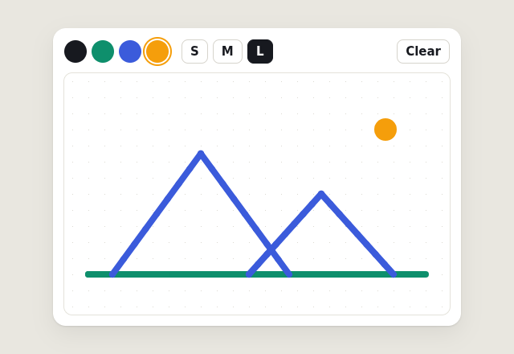
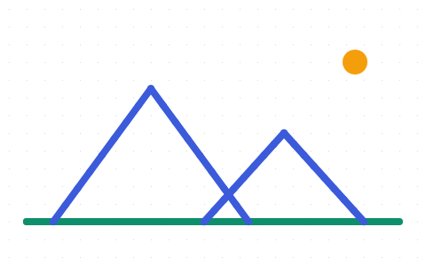

# Canvas drawing app

A small sketch pad drawn on a 2D canvas. The check picks colors and a brush, draws with
real mouse drags at points on the canvas, reads pixels back with `getImageData` to check
what was drawn, and takes two screenshots: the canvas's own pixels, and the page.

## Run it

```sh
cd examples/canvas
npx brokit check --verbose      # --verbose lists every step, as below
```

<!-- output -->

The first run writes the baselines (`checks/baselines/sketch/drawing.png` and
`app.png`); the runs after it compare against them. In a real project you commit the
baselines. They're not committed here, since they depend on the fonts of the machine
that made them.




*The baselines: the app's viewport, and the canvas's own pixels.*

## The page

[index.html](index.html) has a toolbar and a 480×300 canvas. [app.js](app.js) draws
on pointer events: a line from each pointer position to the next while the button is
down, and a dot for a click. When it's set up, it sets `window.sketch.ready`, which the
check waits for.

## The check

The check, [checks/sketch.check.json](checks/sketch.check.json):

<!-- include: checks/sketch.check.json -->

- `"ready": "window.sketch?.ready"` waits for the app's own signal, not just the load
  event: the check starts once the canvas has its paper.
- `{ "selector": "canvas", "offset": [30, 250] }` is a point 30 CSS pixels from the
  canvas's left edge and 250 down, wherever the canvas is on the page. Drawing apps
  think in canvas coordinates; so does the check.
- `drag` presses the mouse button at `from`, moves to `to` in 8 steps, and releases. The
  page gets `pointerdown`, `pointermove` and `pointerup`, as from a real mouse.
- `getImageData(240, 250, 1, 1).data` is the pixel at (240, 250) as red, green, blue
  and alpha. The canvas is as big as it's drawn (480×300 pixels in 480×300 CSS pixels,
  at a device pixel ratio of 1), so canvas pixels and the points above line up.
- `"from": "document.querySelector('canvas')"` takes the screenshot from the page
  itself: the canvas's pixels, without the toolbar or the page around it. It also takes
  an `OffscreenCanvas`, `ImageData` or a PNG data URL. A WebGL canvas needs
  `preserveDrawingBuffer` for this; take a screenshot with `"selector"` instead.
- The last screenshot has no `"from"` or `"selector"`: it's the viewport, as a person
  would see it.

`brokit check` draws with `--gpu software` by default, so a canvas gives the same pixels
on every machine.

## Learn more

- [Steps](../../site/docs/steps.md): points, `drag`, `click` and `screenshot`.
- [Scenarios](../../site/docs/scenarios.md): `ready` and other ways to know a page is
  ready.
- [Checks and baselines](../../site/docs/checks.md): baselines, tolerance and `--gpu`.
