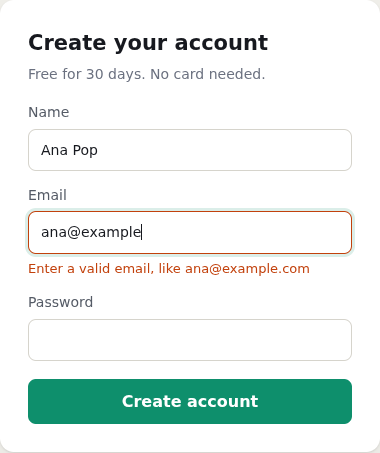
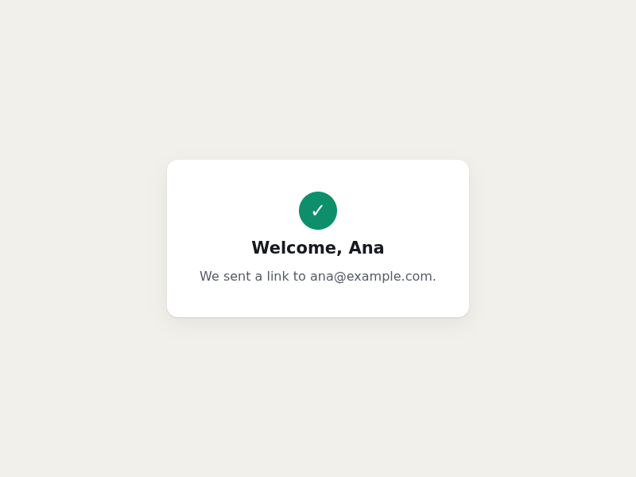
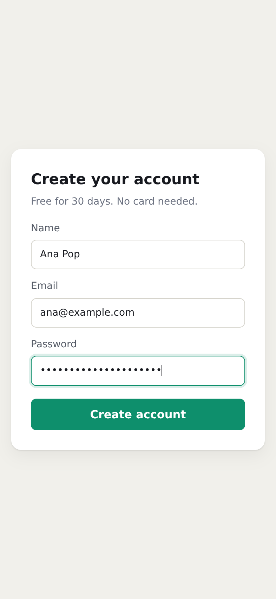

# Sign-up form

A sign-up form, checked twice: on a laptop with clicks and keys, and on a phone with
taps. The checks type into fields, press Enter, check the error and welcome messages
with `expect`, and compare screenshots with their baselines.

## Run it

```sh
cd examples/form
npx brokit check --verbose      # --verbose lists every step, as below
```

<!-- output -->

brokit serves this folder, so `"url": "/index.html"` in a check opens
[index.html](index.html). The first run writes the baselines in `checks/baselines/`;
the runs after it compare against them. In a real project you commit the baselines.
They're not committed here, since they depend on the fonts of the machine that made
them.





*The baselines the checks wrote: a wrong email, the welcome card, and the phone check.*

## The page

[index.html](index.html) is a form with a name, an email and a password.
[app.js](app.js) checks the email when the form is sent: if it's wrong, it shows an
error and puts the cursor back in the field; if it's right, it hides the form and says
welcome.

## The laptop check

The check, [checks/signup.check.json](checks/signup.check.json):

<!-- include: checks/signup.check.json -->

- `{ "click": { "selector": "#email" } }` clicks the middle of the field, as a mouse
  would. `{ "type": "ana@example" }` then types into whatever has focus.
- `{ "key": "Enter" }` presses Enter in the field, which sends the form. The page sees
  the same events as from a keyboard.
- `"equals"` checks the error's exact text; `"matches"` checks the welcome line with a
  regular expression. An expectation is tried again for up to 2 seconds, so a page that
  updates a moment later still passes.
- `"count": 3` is a triple click, which selects all the text in the field, so the next
  `type` replaces it.
- The `checkVisibility()` expectation caught a real mistake while this example was
  written: the form's `display: grid` kept it on screen under the welcome message.
- `"selector": ".card"` takes a screenshot of just the card. Without it, a screenshot is
  the whole viewport.

## The phone check

The check, [checks/signup-phone.check.json](checks/signup-phone.check.json):

<!-- include: checks/signup-phone.check.json -->

- `"viewport": { "size": "393x852", "dpr": 2, "mobile": true }` is a phone: a 393×852
  CSS-pixel screen, 2 device pixels per CSS pixel (so the screenshots are 786×1704), a
  mobile viewport and touch.
- `tap` is a finger, not a mouse: the page gets touch events, then the click that
  follows a tap.
- The first expectation checks that nothing is wider than the phone's screen, a common
  mistake on small screens.

## Learn more

- [Steps](../../site/docs/steps.md): every step, points and expectations.
- [Scenarios](../../site/docs/scenarios.md): scenario files, `viewport` and `ready`.
- [Checks and baselines](../../site/docs/checks.md): `brokit check`, baselines and
  `--update`.
