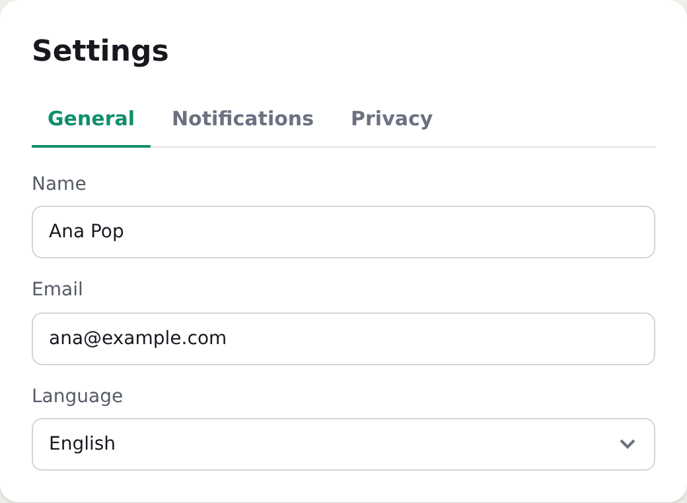
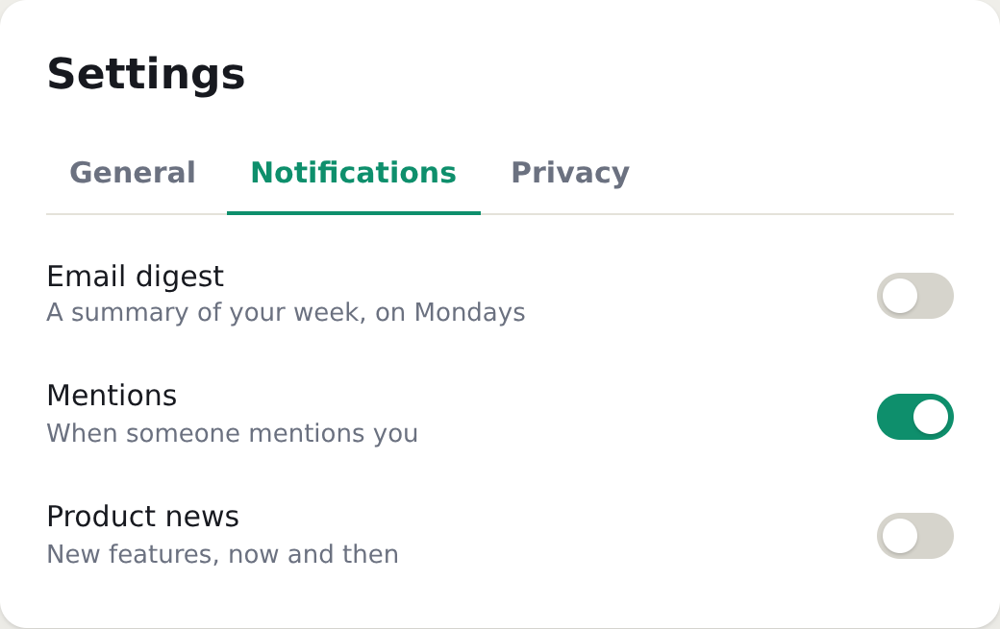
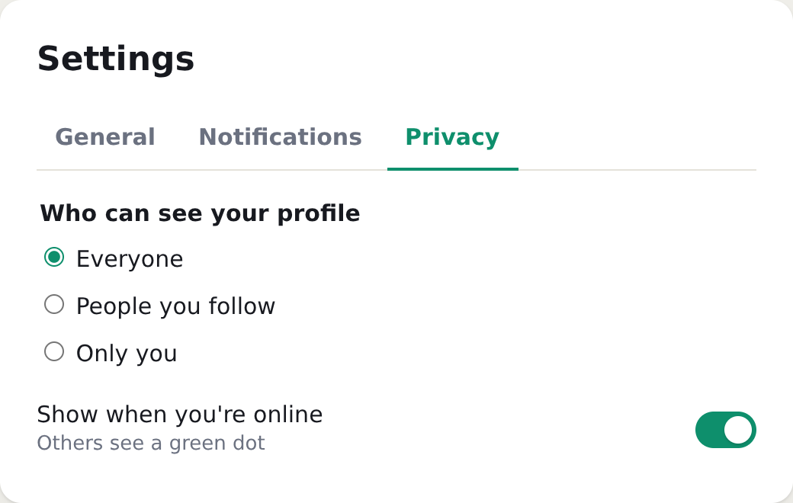

# Tabs in a JS scenario

A settings page with three tabs, checked by a JS scenario: a `*.check.mjs` file whose
function loops over the tabs, checks each one, and takes a screenshot of each. JSON
steps run one after another; a JS scenario adds loops, variables and measurements.

## Run it

```sh
cd examples/js-scenario
npx brokit check --verbose      # --verbose lists every step, as below
```

<!-- output -->

The first run writes three baselines in `checks/baselines/settings/`, one per tab; the
runs after it compare against them. In a real project you commit the baselines. They're
not committed here, since they depend on the fonts of the machine that made them.





*The baselines: one screenshot per tab, from the loop.*

## The page

[index.html](index.html) has a tab list and three panels; [tabs.js](tabs.js) shows the
panel of the tab you click, and moves between tabs with the arrow keys, Home and End,
as the ARIA tabs pattern does.

## The check

The check, [checks/settings.check.mjs](checks/settings.check.mjs):

<!-- include: checks/settings.check.mjs -->

- The named exports are the scenario's settings, the same keys as in a JSON scenario:
  `url`, `viewport`, `ready`, and also `timeout`, `tolerance` and `note`.
- The default export is the function brokit runs once the page is ready. It gets:
  - `page`, with a method for every step (`click`, `tap`, `key`, `type`, `emulate`,
    `eval`, ...) and `rect(selector)`, which gives an element's `{ x, y, width, height }`;
  - `expect`, whose `equal`, `near`, `matches`, `includes`, `atLeast`, `atMost` and `ok`
    each record a check with its label, and return whether it held;
  - `step(...)`, which runs a JSON step and records it, as `{ key }` here;
  - `screenshot(name, options)`, a screenshot step: `{ baseline: true }` compares it
    with its baseline.
- `page.click(...)` acts but isn't listed in the report; `step({ click: ... })` is. Use
  `step` for actions you want to see in the output.
- A failed expectation doesn't stop the function: the loop goes on, so one run shows
  every tab that's wrong. A failed action (a click on something that isn't there) does
  stop it, and the report points at the line.
- The last part measures the page: on a 360-pixel phone, the three tabs must fit in the
  tab bar, on one line.

> **Note:** A JS scenario is code. `brokit check` runs it with Node and your
> permissions, as a test runner runs test files. On a checkout you don't trust, run
> `brokit check --no-js`.

## Learn more

- [Scenarios](../../site/docs/scenarios.md): JS scenarios, and what their function gets.
- [Steps](../../site/docs/steps.md): every step, as a JSON step or a `page` method.
- [Checks and baselines](../../site/docs/checks.md): `brokit check`, baselines and
  `--no-js`.
- [Library](../../site/docs/library.md): the same `page` outside a check.
