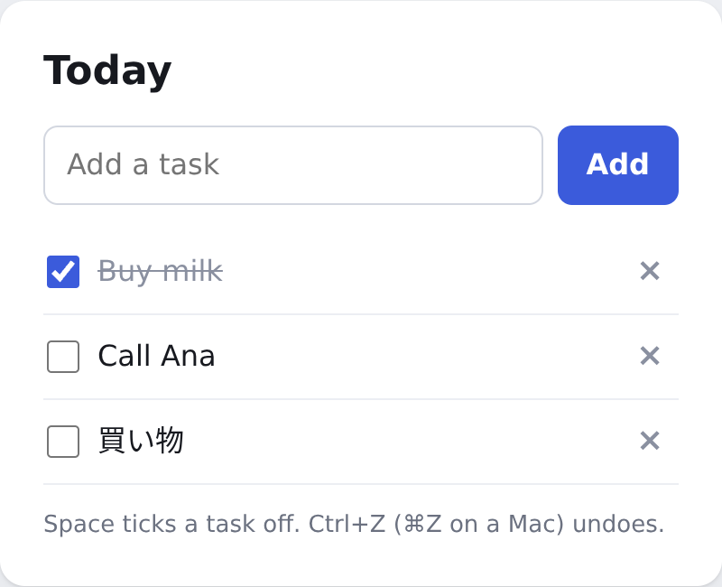

# Keyboard and input methods

A to-do list used with the keyboard only. The check moves focus with Tab, types text at
once and a key at a time, composes Japanese with an input method, ticks a task off with
Space, removes it with Enter and brings it back with undo (`Mod+z`).

## Run it

```sh
cd examples/keyboard
npx brokit check --verbose      # --verbose lists every step, as below
```

<!-- output -->

The first run writes the baseline (`checks/baselines/todo/list.png`); the runs after it
compare against it. In a real project you commit the baselines. They're not committed
here, since they depend on the fonts of the machine that made them (the last task needs
a Japanese font).



*The baseline: the list after the keyboard and the input method were done with it.*

## The page

[index.html](index.html) is a field, an Add button and a list. [app.js](app.js) keeps a
copy of the list before each change, so Ctrl+Z (Cmd+Z on a Mac) undoes the last one,
except in the text field, where it's the field's own undo. For the check to read, it
keeps `window.app`: the tasks, how many keys were pressed in the field, and whether an
input method is composing.

## The check

The check, [checks/todo.check.json](checks/todo.check.json):

<!-- include: checks/todo.check.json -->

- `{ "key": "Tab" }` moves focus as a person's Tab does, so the expectations after it can
  check where focus went with `document.activeElement`.
- `{ "type": "Buy milk" }` inserts the text at once, as a paste or an input method's
  commit does: the page gets an `input` event and no key events, so `app.keys` stays 0.
  With `"perKey": true`, each character is a key press (`keydown`, `keypress`, `keyup`),
  for pages that listen to keys.
- `{ "key": "Mod+z" }` is Ctrl+Z on Linux and Windows and Cmd+Z on macOS, so the same
  check works on all of them. It's pressed twice: in the field it undoes typing, and
  outside it the page's own undo brings the removed task back.
- `{ "ime": "かいもの" }` is an input method composing: the text is in the field,
  underlined, and `compositionstart` has fired. The `type` step after it commits the
  composition with the chosen text; `{ "ime": "" }` would cancel it.
- `{ "key": "Space" }` on a checkbox ticks it, and `Enter` on a button presses it, as
  they do for a person.

## Learn more

- [Steps](../../site/docs/steps.md): `key`, `type`, `ime`, and key names.
- [Scenarios](../../site/docs/scenarios.md): scenario files and `ready`.
- [Checks and baselines](../../site/docs/checks.md): `brokit check` and baselines.
