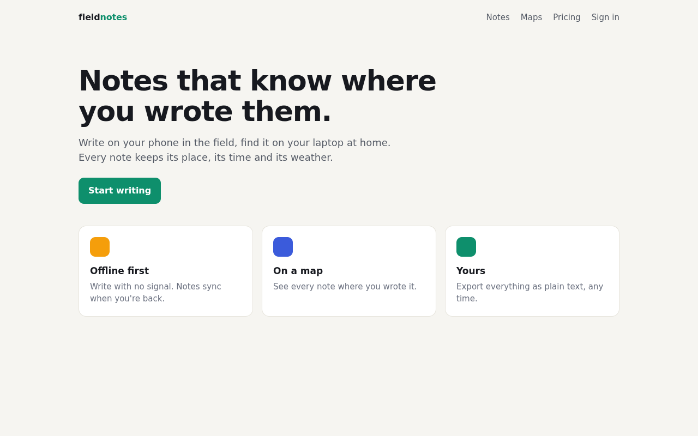
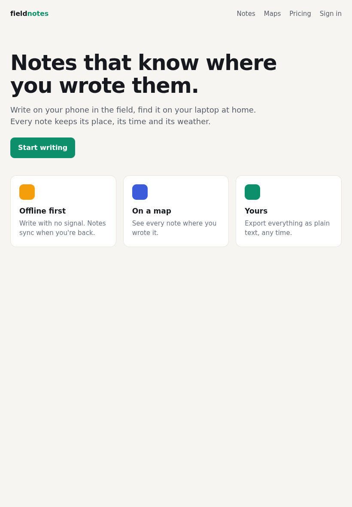
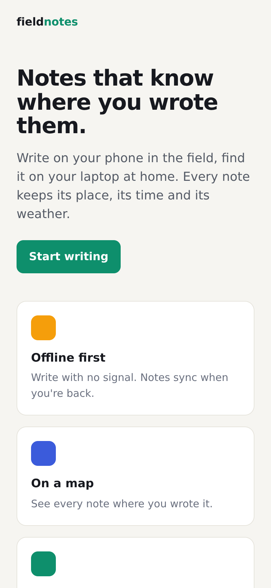

# Screenshots from a script

brokit as a Node.js library: a script that serves this folder, starts Chrome, takes a
screenshot of one page on a laptop, a tablet and a phone, and compares each with the
screenshot from the run before, with `decodePng` and `diffImages`.

## Run it

```sh
cd examples/library
node screenshots.mjs
```

<!-- output -->

Inside this repository, `import ... from 'brokit'` finds brokit itself. In your own
project, install it first: `npm install --save-dev brokit` (until brokit is on npm,
`npm install --save-dev github:radufarcas10/brokit`).

The first run writes `out/laptop.png`, `out/tablet.png` and `out/phone.png`. Each
run after it compares the new screenshots with them, says which changed, and exits 1 if
any did. In a real project, screenshots you compare against are committed. They're not
committed here, since they depend on the fonts of the machine that made them.





*What the script saved: laptop, tablet and phone.*

## The page

[index.html](index.html) is a small landing page whose cards sit in three columns on
a laptop and in one on a phone.

## The script

The script, [screenshots.mjs](screenshots.mjs):

<!-- include: screenshots.mjs -->

- `serve(folder)` serves a folder on 127.0.0.1, on a free port: only files inside it, no
  dotfiles, no directory listings. `server.url` is where it is.
- `launch({ gpu: 'software' })` starts a headless Chrome that draws with SwiftShader, so
  the same page gives the same pixels on every machine. That's what `brokit check` uses
  too.
- `browser.newPage({ size, dpr, mobile })` opens a tab with that screen: `dpr: 2` makes
  the phone's screenshot 786×1704 pixels for its 393×852 CSS pixels, and `mobile: true`
  gives it a phone's viewport and touch.
- `page.goto(url, { ready })` waits until the expression is truthy, then for the page's
  fonts and two frames, so the screenshot is the page as it settled.
- `page.screenshot()` resolves to `{ png, width, height }`: the PNG's bytes, in device
  pixels. It also takes `selector`, `fullPage` and `scale`, as the `screenshot` step does.
- `decodePng` turns PNG bytes into `{ width, height, data }` (RGBA), and `diffImages`
  compares two of them. Its result says whether they `pass` the tolerance, and if not,
  why (`failures`), with a difference `image` to save with `encodePng`.

Every step is also a `page` method (`click`, `tap`, `drag`, `key`, `type`, `emulate`,
`waitFor`, `eval`, ...), and `runScenario(browser, scenario)` runs a whole scenario.

## Learn more

- [Library](../../site/docs/library.md): what brokit exports, and each `page` method.
- [Checks and baselines](../../site/docs/checks.md): tolerance, difference images and
  `--gpu`.
- [Steps](../../site/docs/steps.md): the steps, which are also `page` methods.
