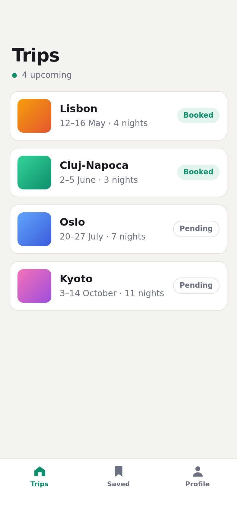
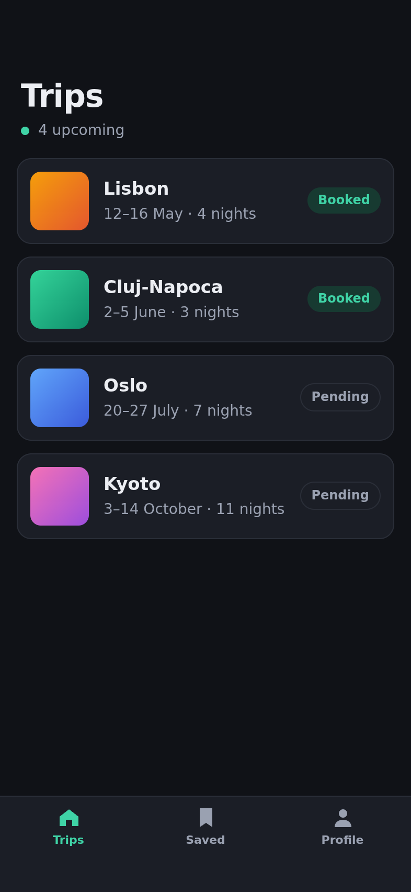

# Phone, notch and dark mode

A responsive page checked as a phone. The check switches the screen to a phone's with
`emulate`, adds a notch and a home bar with `safeArea`, asks for less motion and then
for dark mode, and checks the layout with expressions that measure the page.

## Run it

```sh
cd examples/phone-dark
npx brokit check --verbose      # --verbose lists every step, as below
```

<!-- output -->

The first run writes the baselines (`checks/baselines/trips/light.png` and `dark.png`);
the runs after it compare against them. In a real project you commit the baselines.
They're not committed here, since they depend on the fonts of the machine that made
them.




*The baselines: light and dark, on a phone with a notch.*

## The page

[index.html](index.html) is a list of trips with a header and a tab bar.
[style.css](style.css) does four things a phone page often needs:

- `viewport-fit=cover` in the viewport meta tag lets the page draw under the notch, and
  `env(safe-area-inset-top)` and `env(safe-area-inset-bottom)` pad the header and the
  tab bar so their content stays clear of it.
- `@media (prefers-color-scheme: dark)` swaps the colors.
- `@media (min-width: 700px)` puts the trips in two columns on wider screens.
- A green dot pulses forever, and the cards rise in as the page opens, unless the user
  asked for less motion (`prefers-reduced-motion: reduce`).

## The check

The check, [checks/trips.check.json](checks/trips.check.json):

<!-- include: checks/trips.check.json -->

- The page opens on a 1024×700 laptop screen, where the first expectation sees two
  columns.
- `emulate` turns the screen into a phone mid-run, as DevTools' device mode does: 393×852
  CSS pixels, 2 device pixels per CSS pixel, a mobile viewport and touch. The page lays
  itself out again, and the next expectation sees one column.
- `{ "safeArea": [59, 0, 34, 0] }` gives the screen a 59-pixel notch at the top and a
  34-pixel home bar at the bottom (top, right, bottom, left), as an iPhone has. The page
  sees them through `env(safe-area-inset-*)`.
- The two expectations after it measure the page with `getBoundingClientRect()`: the
  title starts below the notch, and the tab bar's buttons end above the home bar.
  Without the `safeArea` step they fail with `expected ≥ 59, got 12`.
- `"reducedMotion": "reduce"` is what makes the screenshots stable. The pulsing dot never
  stops, so without it two runs catch the dot at different moments: the second run
  fails, and brokit says why (`never stops: span.live: pulse`).
- `{ "emulate": { "colorScheme": "dark" } }` switches to dark mode; what's left out
  (the size, the motion) stays as it was.

## Learn more

- [Steps](../../site/docs/steps.md): `emulate`, `safeArea` and expectations.
- [Checks and baselines](../../site/docs/checks.md): screenshots and motion.
- [Scenarios](../../site/docs/scenarios.md): `viewport` and `ready`.
