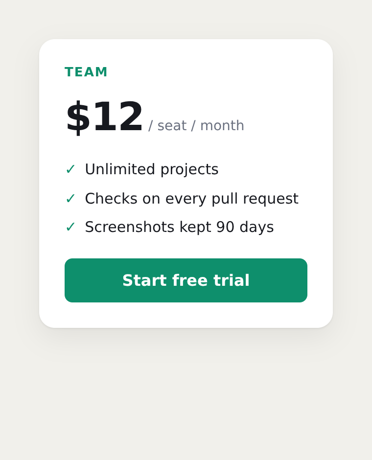
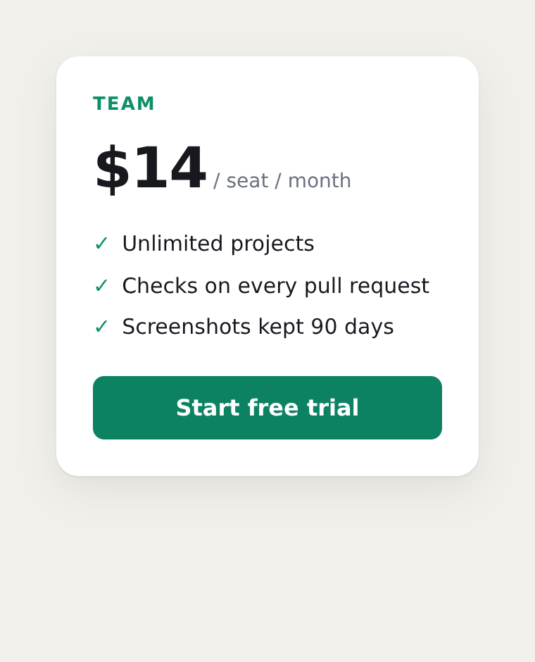
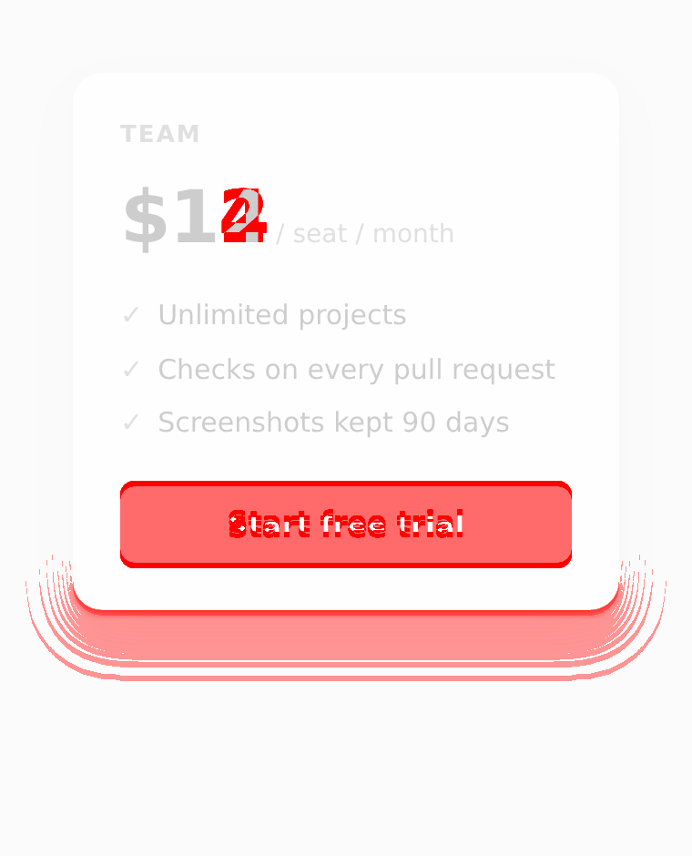

# Checks and baselines

`brokit check` runs every check in a project and tells you what changed: a value that's
wrong, an error the page threw, a screenshot that no longer matches the one you approved.
It's the command for your own computer before you push, and for CI.

```
$ brokit check
brokit check: 3 scenarios, Chrome 155.0.8059.39, software drawing
✗ checks/card  1 step, 1.1 s
    ✗ screenshot card → brokit-out/checks/card/card.png (760×940)  391 ms
        differs from checks/baselines/card/card.png: 55252 pixels differ by more than 2 (up to 243)
        difference → brokit-out/checks/card/card.diff.png
✓ checks/signup-phone  5 steps, 0.4 s
✓ checks/signup  5 steps, 0.3 s
3 scenarios: 2 passed, 1 FAILED in 1.7 s
```

## Running checks

`brokit check` runs every `*.check.json` and `*.check.mjs` under the current folder, or
under the files and folders you name, and exits 1 if any failed. It skips
`node_modules`, hidden folders (`.git`), `brokit-out` and `baselines` folders.

```sh
brokit check                         # everything under this folder
brokit check checks/signup.check.json checks/phone/
brokit check --filter signup         # only checks whose name contains "signup"
brokit check --verbose               # every step, not just the ones that failed
brokit check --json                  # every result, as JSON
brokit check --base http://localhost:5173/   # against your dev server
```

**One Chrome for all of them.** Checks run one after another in a single Chrome, each in
a fresh tab, which is much faster than a Chrome per check: ten checks took 3.1 s of CPU
instead of 8.2 s. A check's name is its file's name without `.check.json`: `signup`, or
`checks/signup` in reports.

## Baselines

A screenshot step with `"baseline": true` is compared with its baseline: the picture of
that screen you approved. Baselines are kept next to the check, so they're committed and
reviewed with the code:

```
checks/
  signup.check.json
  baselines/
    signup/
      welcome.png        ← { "screenshot": "welcome", "baseline": true }
```

What happens to a baseline screenshot:

- **No baseline yet:** it's written and the step passes. Look at it before you commit
  it. In CI (where the `CI` variable is set, as GitHub, GitLab and most others do) it
  fails instead, since a check with nothing to compare with checks nothing.
- **The same, within the tolerance:** the step passes.
- **Different:** the step fails; the new screenshot and a difference image are in
  `brokit-out/`. If the change is what you meant, `brokit check --update` takes it as
  the new baseline. Review the new PNGs in your diff before you commit them, as you
  would code.
- **A page with errors** (an HTTP error such as a 404, an uncaught exception) never
  becomes a baseline, not even with `--update`: the step fails and says why, so a
  server that wasn't running can't replace your baselines with its error page.

A failed baseline doesn't stop the check: the steps after it still run, so one run shows
every screen that changed.

> **Note:** `brokit run` compares baselines too. For a scenario file they're next to the
> file, as with `check`; for a page or URL, in `brokit-baselines/` (`--baselines` to
> change it).

### The difference image

Where a screenshot differs, brokit draws what changed: the baseline faded to grey, the
pixels that differ in red (the stronger, the more they differ), and ignored regions in
blue. Here is a card before and after a change, and what `brokit diff` drew:





*Before, after, and the difference.*

## Tolerance and ignored regions

By default a pixel may be off by up to 2 of 255 in a channel. Nobody can see that, and
it's how much Chrome's drawing of the same page can vary between runs (large blurred
shadows, for one); anything real differs by far more.

Change it on the step, or for every baseline in a scenario with `"tolerance"` at its top:

```json
{ "screenshot": "map", "baseline": true, "tolerance": { "max": 8 } }
{ "screenshot": "chart", "baseline": true, "tolerance": { ">8": "0.1%" } }
{ "screenshot": "logo", "baseline": true, "tolerance": { "max": 0 } }
```

| Tolerance | Holds when |
|---|---|
| `{ "max": 2 }` | no pixel differs by more than 2 (of 255, in its most different channel) |
| `{ "mean": 0.5 }` | the mean difference over all pixels is at most 0.5 |
| `{ ">8": "0.1%" }` | at most 0.1% of the pixels differ by more than 8 |
| `{ ">0": 20 }` | at most 20 pixels differ at all |

Give several and all must hold. `{ "max": 0 }` is pixel-exact.

Leave out parts of the screen that change every time (a clock, an avatar, an ad) with
`"ignore"`, a list of `[x, y, width, height]` in image pixels:

```json
{ "screenshot": "dashboard", "baseline": true, "ignore": [[1040, 16, 220, 32]] }
```

Image pixels are CSS pixels times the device pixel ratio: on a `"dpr": 2` screen, a box at
CSS `[100, 20]` is at `[200, 40]` in the image. Often simpler: screenshot only the part
that matters with `"selector"`.

## Screenshots and motion

A screenshot shows the page once it has stopped moving, not halfway through a fade:
brokit waits for CSS transitions and animations (and Web Animations) that have an end,
and for scrolling to stop (`scroll-behavior: smooth`, `scrollTo({ behavior: "smooth" })`),
up to 5 seconds. A page that's already still costs nothing extra: brokit looks before the
shot, watches while it's taken, and waits and takes it again only if something moved.
`"still": false` takes the shot at once; `"still": 2000` waits at most 2 seconds.

What it can't wait for, it tells you in the step's note: something still moving when
the time ran out, and, for a baseline, an animation that never ends (a spinner, a
blinking cursor drawn in CSS), since that can make two runs differ. Emulate
`"reducedMotion": "reduce"` if the page honors it, or leave that region out with
`"ignore"`. Drawing a page does in its own `requestAnimationFrame` loop isn't seen as
motion, nor is motion inside iframes; wait for those with `"waitFor"`.

Baselines are retaken until two shots in a row match anyway: a new baseline is never a
moment of a page still drawing, and a difference is checked once more before it's
called real.

## Drawing the same everywhere

Two machines can draw the same page slightly differently: another GPU, another driver,
another font. For screenshots you compare, that's noise. `--gpu` picks how Chrome draws:

| `--gpu` | Draws with | For |
|---|---|---|
| `software` | SwiftShader, on the CPU: the same pixels on every machine | screenshots you compare; the default for `check` |
| `hardware` | the real GPU (and WebGPU) where the platform allows it headless | WebGPU, performance |
| `default` | Chrome's own choice | the default for `run` |

Fonts and the Chrome version matter too. Make and update baselines where CI runs (the
same container image), and pin Chrome with `brokit install-chrome --pin`: see
[CI and containers](ci.md#baselines-in-ci).

## Comparing images

`brokit diff` compares any two PNGs, the same way baselines are compared:

```sh
brokit diff before.png after.png diff.png
brokit diff before.png after.png --tolerance '{"max": 2}'
brokit diff before.png after.png --tolerance '{">8": "0.1%"}' --ignore '[[0, 0, 200, 40]]'
```

```
$ brokit diff before.png after.png diff.png
before.png vs after.png
  760×940, 714400 pixels compared
  identical 87.298 %   ≤2 4.968 %   ≤8 0.347 %   ≤32 5.431 %   >32 1.956 %
  mean 4.2574, worst 243
  difference image → diff.png
  FAILED: 90745 pixels differ (up to 243)
```

It counts pixels by how much they differ (identical, ≤2, ≤8, ≤32, >32 out of 255),
reports the mean and the worst, and draws the difference image. Without a tolerance, any
difference fails. It exits 0 when the images match within the tolerance, 1 when they
don't, and works on screenshots from anywhere, not just brokit's.
